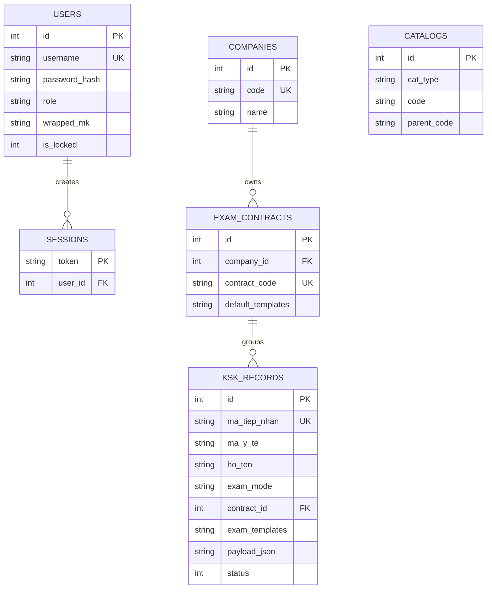

# Kiến trúc KSK Webapp
## 1. Tổng quan
KSK Webapp là ứng dụng desktop native quản lý khám sức khỏe cho cơ sở khám bệnh, chữa bệnh. Hệ thống hỗ trợ khám lẻ, khám đoàn theo công ty/hợp đồng, phân quyền theo chuyên khoa, tích hợp HIS, in biểu mẫu và xuất dữ liệu theo chuẩn KSK.
Kiến trúc hiện tại gồm:
```text
Người dùng / HIS Bridge
          |
          v
   GPUI Desktop Application
          |
   +------+-------+----------------+
   |              |                |
   v              v                v
 SQLite       Crypto layer    Import/Export
 database     Master Key      CSV/XLSX/PDF/DOCX
```
Ứng dụng được khởi động từ `src/main.rs`. Tokio cung cấp runtime bất đồng bộ; GPUI quản lý cửa sổ và giao diện; SQLx kết nối SQLite; Axum cung cấp Local HIS IPC.
## 2. Thành phần hệ thống
### 2.1. Bootstrap và runtime
`src/main.rs` thực hiện các bước:
1. Khởi tạo tracing log và panic hook, ghi vào `ksk_app.log`.
2. Dọn executable cũ sau cập nhật.
3. Đọc `config.toml` và `database.toml` qua `AppConfig`.
4. Khởi tạo SQLite pool và schema.
5. Tạo `AppState` dùng chung cho giao diện và các tác vụ nền.
6. Mở Local HIS IPC tại `127.0.0.1:<local_ipc_port>`.
7. Khởi tạo cửa sổ GPUI và root view `KskGpuiApp`.
`AppState` gồm:
```text
db          RwLock<SqlitePool>
config      RwLock<AppConfig>
master_key  RwLock<Option<[u8; 32]>>
http_client reqwest::Client
his_push_tx broadcast::Sender<String>
```
### 2.2. Giao diện GPUI
Các module trong `src/gui/` được tổ chức theo trách nhiệm:
| Module | Trách nhiệm |
|---|---|
| `mod.rs` | Root app, trạng thái phiên, điều hướng và helper chung |
| `sidebar.rs` | Danh sách hồ sơ, bộ lọc khám lẻ/khám đoàn |
| `tabs_exam.rs` | Tiếp nhận, tiền sử, thể lực, lâm sàng, cận lâm sàng, kết luận |
| `tab_group_exam.rs` | Công ty, hợp đồng, import và tiến độ khám đoàn |
| `tab_export_admin.rs` | Xuất dữ liệu, backup, database, update và người dùng |
| `tab_catalogs.rs` | Quản lý danh mục |
| `widgets.rs` | Field, button, badge và style dùng chung |
Điều hướng cấp cao:
```text
exam    Hồ sơ khám
group   Khám đoàn
export  Xuất dữ liệu
admin   Quản trị
```
### 2.3. Domain model và RBAC
`src/models.rs` định nghĩa:
- DTO cho người dùng, hồ sơ, công ty, hợp đồng và danh mục.
- Danh sách role hợp lệ.
- Nhóm trường mà mỗi role được phép sửa.
- Danh sách 123 cột CSV.
- Helper kiểm tra quyền và merge payload.
Role hiện có:
```text
admin, business, reception, tiensu, bs_theluc,
bs_noi, bs_ngoai, bs_dalieu, bs_san, bs_mat,
bs_tmh, bs_rhm, bs_cls, bs_ketluan
```
Một tài khoản có thể có nhiều role, lưu trong `users.role` dưới dạng chuỗi phân tách bằng dấu phẩy. Quyền được kiểm tra ở cả giao diện và lớp xử lý dữ liệu. `admin` có quyền đầy đủ; các role chuyên khoa chỉ được sửa section tương ứng.
## 3. Database
### 3.1. Kết nối
`src/db.rs::init_db` tạo database nếu chưa có và dùng:
- SQLite `JournalMode::Delete`.
- `Synchronous::Full`.
- `busy_timeout` 15 giây.
- Pool tối đa 3 connection.
Cấu hình này phù hợp với việc nhiều máy trạm dùng chung file SQLite qua LAN/SMB, đồng thời tránh phụ thuộc vào các file `-wal` và `-shm` trong thư mục chia sẻ.
### 3.2. Schema chính

Các bảng khác:
- `app_settings`: cấu hình hệ thống.
- `catalog_meta`: thời điểm cập nhật danh mục.
Schema được tạo/nâng cấp tại runtime bằng `CREATE TABLE IF NOT EXISTS` và các lệnh `ALTER TABLE` tương thích ngược.
### 3.3. Mô hình hồ sơ
Các trường dùng để tìm kiếm và lọc được lưu ở cột riêng như `ma_tiep_nhan`, `ma_y_te`, `ho_ten`, `ngay_sinh`, `exam_mode`, `contract_id`. Dữ liệu khám mở rộng được lưu trong `payload_json` để dùng chung cho nhiều mẫu phiếu.
`exam_templates` chứa một hoặc nhiều mã template, phân tách bằng dấu phẩy:
```text
TREN_18
TREN_18,LAI_XE
```
Các template phụ dùng namespace riêng, ví dụ `LX_`, `D6_`, `U18_`, `MG_` và `HS_`.
## 4. Bảo mật
### 4.1. Master Key
`src/crypto.rs` tạo Master Key 32 byte cho database. Master Key được bọc riêng bằng:
- Mật khẩu tài khoản.
- Recovery Key dành cho khôi phục quản trị.
Quy trình sử dụng PBKDF2-HMAC-SHA256 với salt ngẫu nhiên và AES-256-GCM với nonce ngẫu nhiên. Chuỗi bọc có prefix `MK1:`.
### 4.2. Mã hóa dữ liệu hồ sơ
Các trường nhạy cảm được mã hóa bằng Master Key:
- `ho_ten`
- `ngay_sinh`
- `so_cccd`
- `payload_json`
Mỗi giá trị có nonce riêng và prefix `ENC1:`. Khi Master Key chưa được mở khóa, ứng dụng không trả plaintext mà hiển thị trạng thái `[Đã mã hóa]`.
### 4.3. Ranh giới bảo mật
- Session được lưu trong bảng `sessions` và xác thực qua bearer token ở các HTTP handler.
- Người dùng bị khóa không thể đăng nhập.
- Backup vẫn chứa dữ liệu y tế và phải được bảo vệ như database gốc.
- Không commit database thật, Recovery Key, mật khẩu hoặc API key vào repository.
## 5. Các luồng nghiệp vụ
### 5.1. Khám lẻ
```text
Tiếp nhận
  -> tạo hoặc tìm hồ sơ
  -> mở khóa Master Key
  -> các chuyên khoa cập nhật section được cấp quyền
  -> kết luận và khóa hồ sơ
  -> in hoặc xuất dữ liệu
```
### 5.2. Khám đoàn
```text
Công ty
  -> Hợp đồng khám
  -> import CSV/XLSX/XLS
  -> preview và kiểm tra lỗi
  -> tạo hồ sơ exam_mode = group
  -> khám theo tiến độ
  -> lọc/in/xuất theo contract_id
```
`src/group_import.rs` chịu trách nhiệm:
- Đọc CSV hoặc sheet đầu tiên của Excel.
- Ánh xạ các tên cột phổ biến.
- Chuẩn hóa ngày và giới tính.
- Đối chiếu mã/tên danh mục.
- Trả về danh sách dòng hợp lệ và lỗi để preview trước khi ghi.
### 5.3. Tích hợp HIS
Ứng dụng mở HTTP listener localhost bằng Axum:
```text
POST /api/his/push
POST /api/his/mock
```
Handler nhận mã bệnh nhân hoặc mã tiếp nhận, upsert dữ liệu vào SQLite và phát sự kiện qua broadcast channel. GUI nhận sự kiện để tìm hoặc mở hồ sơ tương ứng.
## 6. In và xuất dữ liệu
### PDF
`src/pdf_print/` dựng PDF A4 trực tiếp bằng `printpdf`. Mỗi mẫu có renderer riêng trong `src/pdf_print/forms/`. `values.rs` chuẩn hóa cách đọc giá trị và danh mục; `primitives.rs` cung cấp primitive vẽ và mã vạch Code 128.
### DOCX
Template DOCX nằm trong `asset/`. Handler xử lý file DOCX như ZIP/XML, thay thế các placeholder bằng dữ liệu hồ sơ và trả về file kết quả.
### CSV
`models::CSV_EXPORT_COLUMNS` là nguồn chuẩn của 123 cột. Dữ liệu có thể được lọc theo trạng thái, loại khám và hợp đồng trước khi xuất.
## 7. Backup, database và cập nhật
- Backup thủ công hoặc tự động theo `backup_interval_minutes`.
- File backup có dạng `ksk_backup_<timestamp>.db`.
- `backup_keep_count` giới hạn số bản sao được giữ.
- Admin có thể tạo database mới hoặc chuyển database đang sử dụng.
- Có thể xuất dữ liệu các hợp đồng được chọn sang SQLite riêng.
- `updater.rs` kiểm tra thư mục cập nhật, thay thế executable và dọn file cũ khi khởi động.
## 8. Cấu trúc mã nguồn
```text
src/
  main.rs             Khởi động ứng dụng, runtime và Local HIS IPC
  config.rs           Cấu hình ứng dụng
  crypto.rs           Master Key và mã hóa trường
  db.rs               Schema, truy vấn, backup và database switch
  models.rs           DTO, role, field map và 123 cột CSV
  handlers.rs         HTTP handler, HIS và pipeline xuất
  group_import.rs     Parser CSV/Excel khám đoàn
  templates.rs        Định nghĩa các mẫu khám
  gui/                Giao diện GPUI
  pdf_print/          Renderer PDF A4
  updater.rs          Cập nhật ứng dụng
asset/
  template*.docx
  seed_catalogs.tsv
  phan_loai_config.json
```
## 9. Nguyên tắc mở rộng
1. Đặt migration và truy vấn database trong `db.rs`.
2. Đặt DTO, role và field permission dùng chung trong `models.rs`.
3. Không đưa nghiệp vụ import/export vào view GPUI.
4. Khi thêm trường có dữ liệu nhạy cảm, cập nhật pipeline mã hóa/giải mã.
5. Khi thêm role, cập nhật danh sách role, nhãn giao diện và field permission.
6. Khi thêm template, cập nhật `templates.rs`, renderer PDF và template DOCX.
7. Bổ sung test cho parser, crypto, template hoặc helper mới.
## 10. Giới hạn hiện tại
- SQLite trên LAN/SMB phụ thuộc vào locking và độ ổn định của mạng.
- GPUI và một số dependency được tối ưu cho Windows; build trên hệ điều hành khác có thể cần điều chỉnh.
- Một số handler Axum và thư mục `ui/` được giữ để tương thích với luồng cũ; giao diện chính hiện tại là GPUI.
